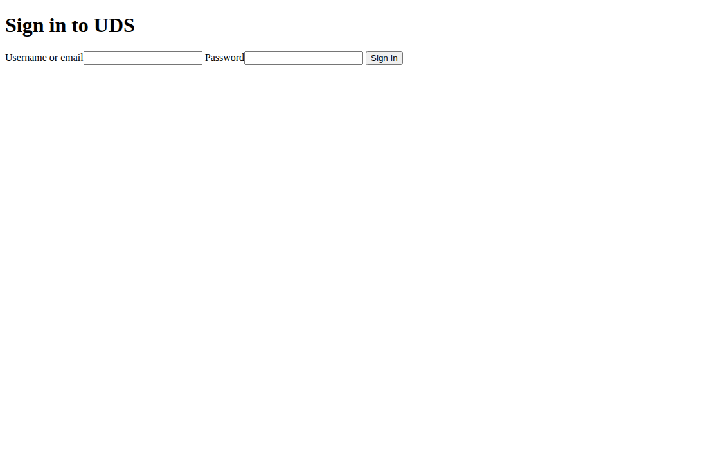

<!--
Copyright 2026 Defense Unicorns
SPDX-License-Identifier: AGPL-3.0-or-later OR LicenseRef-Defense-Unicorns-Commercial
-->

# Standalone development identity

The standalone development identity profile replaces the local Keycloak process with a Go credential and management service plus two Dex issuers. It retains the existing Pepr operator and admission runtime. Its independent Go module does not import or deploy the Go controller migration. You select the same password-only authentication contract that Core's disposable browser-test fixture uses. Dex signs OpenID Connect (OIDC) tokens; the Go service verifies bcrypt credentials and maintains users, client metadata, and sessions through Kubernetes.

The development provider persists through owned Kubernetes Secrets and Dex custom resources. It does not mount Java Keycloak's data, theme, configuration, or provider volumes. Selecting native identity suppresses those PVCs and the Java volume-permission migration exemption. The original Keycloak provider retains its existing PVC behavior, including data and theme persistence in development mode.

The development sign-in page provides the supported username and password flow.



## Select the authentication contract

Apply [the password-only values](../../src/dev-identity/values.password-only.yaml) to the Keycloak chart. Set `insecureAdminPasswordGeneration.enabled: true` for a headless disposable install, or supply the existing `keycloak-admin-password` Secret with `username` and `password` keys. The management service checks that Secret on every authenticated administrative operation and invalidates issued management tokens after credential rotation.

This profile requires `devMode: true`, one bridge replica, and explicit disabled values for OTP, X509 login, social login, WebAuthn, and X509 MFA. The chart rejects required email-verification or terms flows, custom realm password policies, and custom realm token-mapper or client-scope configuration. The runtime rejects unknown authentication requirements, unsupported client authentication methods, SAML clients, required user actions, and token mappers it cannot enforce. Supported audience mappers supply configured access-token audiences for uptime service accounts. Cross-client ID-token pairing requires an additional verified operator provenance producer and remains disabled in the standalone Pepr profile.

The development provider does not implement Java Keycloak's login-attempt throttling, per-user session limits, account inactivity expiration, or account lockout policies. The chart rejects nonzero `SSO_SESSION_MAX_PER_USER`, enabled `ACCOUNT_INACTIVITY_DAYS`, customized `realmConfig.maxInFlightLoginsPerUser`, and unrecognized `realmInitEnv` settings. The inherited Java default of 300 in-flight logins has no effect on this provider. Use the standard Java provider when you require these controls.

This provider supports only the `uds` realm and the two configured public and admin issuer origins. The chart rejects another realm. If you add a gateway for a third SSO hostname, the bridge rejects its discovery, authorization, and browser login requests with HTTP 421. It does not create an issuer from a request header. Core's alternate-SSO-host scenario requires the Java provider. Internal operator and Fleet management, token, and certificate requests remain available through the service backchannel.

The profile preserves the public issuer `https://sso.<domain>/realms/uds` and the admin issuer `https://keycloak.<adminDomain>/realms/uds`. Each issuer has independent Dex storage and signing keys. Browser sessions belong to their issuing host. Managed interactive clients receive real Dex `profile`, `email`, and `groups` defaults, including when Core Authservice requests only `openid`. An explicit supported `defaultClientScopes` list replaces those profile defaults; an empty list preserves that choice. The bridge leaves state, nonce, Proof Key for Code Exchange (PKCE), and redirect bindings unchanged. It rejects custom or role scopes that this profile cannot enforce. The Go bridge retains Core's current login labels, account path, and `KEYCLOAK_SESSION` cookie contract for the browser fixtures. Its pages include real `head` and `body` elements so the stock gateway classification filter can inject the configured frame. Sign-in ends on a same-origin document before starting the OIDC navigation. This keeps `form-action 'self'` enforced without applying the form's restriction to the registered application's callback. The bridge rejects external, protocol-relative, and malformed return targets before rendering that navigation.

The bridge rejects unregistered redirect URIs before displaying the login form. It returns Keycloak-compatible endpoint URLs in discovery and checks each browser token request against the client's current `webOrigins`. Clearing the client's origins revokes that browser access. Discovery and token preflight responses vary by origin; a successful preflight does not authorize the subsequent token request.

The development administration page manages users and clients through the supported API. Its cookie-capability iframe reports `unsupported` without reading or setting cookies. It does not provide Java Keycloak's console assets or browser session-status iframe. Tests that require those Java resources and dynamically added issuer hosts do not qualify this provider. Keep them enabled for the standard provider and qualify the development provider's documented login, group, revocation, and persistence behavior separately.

## Public clients and pairing boundary

Public authorization-code clients require declared `S256` Proof Key for Code Exchange (PKCE). Both authorization endpoint spellings reject missing, plain, malformed, or duplicate challenges before login. Both token endpoint spellings reject missing or malformed verifiers; Dex checks the stored challenge and rejects older unbound public codes. Confidential clients retain their existing behavior unless you declare an `S256` requirement.

The existing Core `ALLOW_PUBLIC_CLIENTS` flag still controls public-client admission. You can use ordinary public clients with their own audience. The original Pepr operator does not emit the qualified cross-client provenance contract, so this standalone profile rejects paired CLI audience registration and signing by default. Set neither `nativeIdentity.coreAudiencePairsEnabled` nor its runtime equivalent to bypass that boundary. The chart rejects pairing when you select the original `pepr-system/pepr-uds-core` identity.

A later integration must provide a verified provenance producer, select its exact service-account principal, and explicitly enable `nativeIdentity.coreAudiencePairsEnabled`. The retained implementation accepts reserved attributes only from the authenticated operator. It then reads the authoritative Kubernetes `Package`, checks its immutable UID, verifies the complete client projection and digest, and restricts trust to the declared public-S256 and confidential Authservice pair. The read-only wire contract contains only identity fields; it does not depend on the Go controller module. The captured contract corpus covers all optional fields, omitted values, and explicit empty values.

The retained grant checks reject user-supplied reserved scopes, foreign targets, changed or deleted `Package` UIDs, unsupported grants, and partial two-issuer publication. Dex binds codes and refresh grants to the original Package UID and exact client pair. A same-name replacement cannot revive an earlier grant. Both issuer and process-recreation regressions remain in the standalone test suite. Those tests qualify the authority implementation, not an unchanged Pepr producer or a live standalone pairing deployment.

Core's Authservice policy invokes cookie-based login only when the `Authorization` header is absent. Bearer requests instead pass through Istio's signature, issuer, audience, and group checks. This provider split does not enable or qualify a hosted Kubernetes broker.

## Provide the runtime inputs

The chart accepts the following development inputs:

| Field under `nativeIdentity` | Default | Purpose |
| --- | --- | --- |
| `bridgeImage`, `dexImage` | Local derivative tags | Select the built Go service and matching Dex derivative. |
| `tlsSecret` | `uds-native-identity-tls` | Supply the private transport certificates and trust root. |
| `publicStorageNamespace`, `adminStorageNamespace` | `keycloak-dex-public`, `keycloak-dex-admin` | Keep issuer state and signing keys separate. |
| `controllerNamespace`, `controllerServiceAccount` | `pepr-system`, `pepr-uds-core` | Authorize the original Pepr operator account for scoped management. |
| `coreAudiencePairsEnabled` | `false` | Keep cross-client CLI pairing disabled until a verified provenance producer exists. |
| `fleetNamespace`, `fleetServiceAccount` | `uds-fleet-command`, `uds-fleet-command-sa` | Authorize Fleet's exact service-account identity and client prefix. |
| `bootstrapUsers`, `bootstrapClients` | Empty lists | Initialize owned state once. User records contain bcrypt hashes, not plaintext passwords. |
| `bridgeResources`, `dexResources` | 25m CPU and 32Mi memory requests per process | Set development resource requests and limits. |

The TLS Secret must contain `ca.crt`, `identity.crt`, `identity.key`, `dex.crt`, `dex.key`, `bridge-client.crt`, `bridge-client.key`, `dex-client.crt`, and `dex-client.key`. Serving certificates must cover `localhost` and any directly used public or cluster names. Client certificates must permit client authentication. Rotate the Secret and restart the StatefulSet to reload the bridge's trust and serving certificates.

The bridge serves Core's gateway and ambient backchannel on port 8080, direct HTTPS on 8443, private mutual TLS (mTLS) lookups on 9443, and actual Go health and metrics on 9000. Dex uses distinct loopback HTTPS, gRPC, and telemetry ports for each issuer. The existing Istio waypoint and admission policies continue to control access to the public, admin, and backchannel paths.

## Preserve state and authority

The bridge stores owned user, group, client, browser-session, and administrative-token records as Secrets in `keycloak`. It stores bearer-token digests rather than bearer values. Bootstrap initialization runs once, so restarting the service does not recreate deleted users or overwrite changed credentials. Dex stores authorization requests, refresh tokens, signing keys, and clients in its upstream Kubernetes storage resources. The generated chart includes the ten pinned Dex storage definitions. Client reconciliation reads one desired-state snapshot and one client list per issuer, then skips unchanged client writes. After both issuers match, it reads the exact owned publication acknowledgements in one Kubernetes list. A periodic scan defers while a mandatory management reconciliation already holds the client lock. The next idle scan performs the complete checks; an actual scan failure still affects readiness. This avoids consuming a periodic deadline while waiting behind a writer. Tombstones cannot add per-record publication reads to every management update. Signing reuses one authoritative client snapshot for user and grant-generation validation; token checks retain current publication and live Package checks. The bridge replaces clients when Dex's update API cannot clear a name, redirect list, or trusted-peer list. An older deletion record cannot finalize a newer live client that reuses its logical client ID. After reconciliation, the bridge rechecks each issuer's final client catalogue before acknowledging publication. It compares normalized client records and skips unchanged management writes. Client publication binds a digest to the exact desired revision and derived trusted peers. The bridge fences changed clients and their audience dependencies before mutation, then releases those revisions only after both issuers match. Incomplete publication blocks affected grants across process replacement while unrelated published clients remain available. A stale publication acknowledgement cannot authorize a newer revision. The bridge bounds its shared Kubernetes API budget at 20 requests per second with a burst of 40 so reconciliation does not exhaust the default client budget during interactive sign-in.

The credential service strips incoming `X-Remote-*` headers. It sends directory identity to Dex only after authenticating the connector callback. Dex checks the private directory at issuance and refresh, including required `groups.anyOf` memberships. Disabling a user or changing credentials advances a persistent session version; a late login or old refresh token cannot cross that revocation boundary. Already issued access tokens expire after their configured five-minute lifetime. Ordinary application sessions receive a real Dex refresh grant without requiring the caller to request a long-lived offline session. The bridge requests Dex's `offline_access` scope for this compatibility, and the chart enables rotation with an eight-hour absolute lifetime and a thirty-minute idle limit. Refresh rechecks directory identity, required groups, credential version, and completed client publication. This profile does not provide unbounded offline credentials.

Administrator and operator management grants issue opaque, management-scoped bearer tokens. OIDC grants and service-account access tokens use actual Dex signatures. Operator client-secret authentication uses `keycloak-client-secrets[uds-operator]`. Projected-token authentication uses Kubernetes `TokenReview` with the exact audience `http://keycloak-http.keycloak.svc.cluster.local/realms/uds`, exact configured service-account names, and bound service-account and Pod identities. Fleet can manage only `fleet-` clients and cannot rename one outside that prefix or delete an unowned client.

Fleet management is disabled by default. Set the original Core `realmInitEnv.FLEET_CLIENT_ENABLED` toggle to `"true"` to enable its development test contract, as Core's `test/values/k3d-standard/values.yaml` does. The development runtime maps that opt-in to `fleetClientEnabled`; missing or false rejects Fleet exchanges and previously issued Fleet management bearer tokens. Disabled startup removes Fleet bearer grants before serving, so enabling Fleet again cannot revive them. Pepr operator projected-token authentication retains its separate authority. Applying a changed configuration requires restarting the bridge so its serving authority reads the new flag.

Fleet's bound identity checks require the chart's `uds-native-fleet-bound-identity` Role and RoleBinding in the configured Fleet namespace. They permit reading only the named service account and Pods in that namespace. Deleting the namespace also deletes these grants. Restore them through the chart or the Fleet fixture deployment after namespace recreation. A native-development assembly helper is outside this standalone PR. Namespace recreation without restoring authority fails closed; the bridge retains the bound Pod and service-account UID checks.

The chart defaults to the actual original Pepr service account, `pepr-system/pepr-uds-core`, used by both admission and watcher deployments. Operator client-secret authentication retains `keycloak-client-secrets[uds-operator]`. Projected tokens retain the original exact Keycloak audience. Administrative mutations emit compatibility audit events for existing notification rules. Java runtime metrics and Keycloak-specific authentication plugins remain outside this development profile.

## Build and verify the provider

Use the [provider build script](../../src/dev-identity/build-images.py) to build both actual runtime images from public source inputs. It requires Python 3.9 or later, Go 1.27.3, Git, and Docker with Buildx. The [input pins](../../src/dev-identity/provider-inputs.json) select Linux AMD64, `CGO_ENABLED=0`, the upstream Dex commit, the development patch digest, and the distroless base. The [bridge image recipe](../../src/dev-identity/Dockerfile.bridge) and [Dex image recipe](../../src/dev-identity/Dockerfile.dex) run the static binaries as user `65532:65532` without adding a shell.

Run the build from the Core repository root with absolute tool paths and a new output directory:

```bash
python3 src/dev-identity/build-images.py \
  --go /absolute/path/to/go1.27.3/bin/go \
  --git /absolute/path/to/git \
  --docker /absolute/path/to/docker \
  --output /tmp/native-identity-build \
  --bridge-image uds-core-dev-identity:local \
  --dex-image uds-core-dev-dex:local \
  --save-images
```

The script clones upstream Dex commit `11d2eeb52b42e1980e14cb91e69dd9e3faab2076` into that output directory and verifies the [Core development patch](../../src/dev-identity/dex-core-dev.patch) before applying it. You can select an existing Git checkout or HTTPS mirror with `--dex-repository`; the script clones committed source and excludes any local working-tree changes. The derivative adds opt-in authenticated directory refresh, directory-backed service-account grants, exact managed claims, mandatory public-client S256, and user authorization at token issuance. The build creates local images and an optional `images.tar`; it does not read private runtime configuration, publish images, or change a cluster.

`build-receipt.json` records the source, patch, tool, binary, and local image digests. Supply `--expected-bridge-binary SHA256` and `--expected-dex-binary SHA256` to reject a binary that differs from a qualified checkpoint before creating images. Both modes use `-trimpath` and strip debug information and symbol tables with `-ldflags '-s -w'`. The default `release` mode adds `-buildvcs=false` so a fork commit, clone, or source archive does not change the binary's embedded VCS metadata. The receipt records the build inputs separately.

Select `--mode historical` when you must verify an earlier checkpoint that retained Go's VCS metadata. Exact reproduction also requires its Git revision and modified-state value; the initial qualification used the original Core base revision with a modified working tree. A new fork commit or source archive cannot reproduce that historical metadata. The script still compares the actual binary hash and rejects a mismatch. Docker image manifests can differ because a rebuild changes image metadata even when both binary hashes match; qualify the resulting digest before selecting it for a deployment.

Run the standalone module tests from `src/dev-identity` before deployment:

```bash
GOWORK=off go test -race ./...
```

Run the matching Dex `server`, `cmd/dex`, and `connector/authproxy` tests, then qualify the deployed image with Core's unchanged hostname, Fleet, notification, and browser tests. Live qualification must verify both signed issuers, required groups, disabled users, credential reset, cleared redirect and audience policy, and restart persistence with TLS verification enabled. A source test or chart rendering pass does not establish a live protocol or browser pass.

## Verify restart persistence

The [protocol probe](../../src/dev-identity/cmd/identity-probe/main.go) verifies actual code exchanges, signed claims, revocation, and process recreation. Give it a private JSON file containing `RootCA`, `PublicOrigin`, `AdminOrigin`, `AdminUsername`, `AdminPassword`, and an optional `HostIPs` map for isolated gateway routing. `RootCA` must identify the certificate authority that signs the public gateway certificates. The probe preserves the original hostnames for TLS verification even when `HostIPs` selects an isolated address. Protect the configuration and probe-generated token state with mode `0600`.

Build and run the probe from `src/dev-identity`:

```bash
GOWORK=off go build -o /tmp/identity-probe ./cmd/identity-probe
/tmp/identity-probe --lifecycle /absolute/private/identity-lifecycle.json
/tmp/identity-probe --restart-prepare /absolute/private/identity-lifecycle.json
```

After preparation, restart the identity StatefulSet and verify promptly, before the original five-minute ID tokens expire:

```bash
kubectl rollout restart statefulset/keycloak -n keycloak
kubectl rollout status statefulset/keycloak -n keycloak --timeout=120s
/tmp/identity-probe --restart-verify /absolute/private/identity-lifecycle.json
```

The verifier checks the original token's signature, issuer, audience, and expiry after restart, then checks the persistent browser session and a real refresh exchange for each issuer. It also verifies fresh signed directory claims and the original authorization nonce. The probe cleans up only the test user and clients it created.

If coordination lets the original token expire, use `--restart-persistence` to check browser sessions and refresh grants separately. That mode requires the normal verifier to reject the original ID tokens as expired and labels original signing-key persistence as unqualified. Prepare a new cycle to qualify the signing keys; an expired token cannot establish that result.


## Qualification boundary

The independent split changes the Go module path, adds the explicit pairing guard, and selects the original Pepr principal. Rebuild the bridge and qualify the resulting image digest before deployment. Historical combined-profile browser, Fleet, restart, and CLI receipts do not establish live parity for this independent branch. The split checks include race tests, captured client-contract comparisons, exact Pepr authority tests, default Keycloak and development chart renders, and provider builds. The unchanged Dex patch retains its pinned digest.

The chart leaves `nativeIdentity.enabled` false. Existing Keycloak deployments retain their original stateful process, persistence, and authentication settings. This PR contains no native admission policies, replacement controller, or native-development assembly.

## Related documentation

- [Identity and authorization configuration](../reference/configuration/identity-and-authorization.mdx) - the surrounding Core chart values.
- [Group-based access](../how-to-guides/identity-and-authorization/enforce-group-based-access.mdx) - Core's required client memberships.
- [Service accounts](../how-to-guides/identity-and-authorization/configure-service-accounts.mdx) - application and probe identity contracts.
