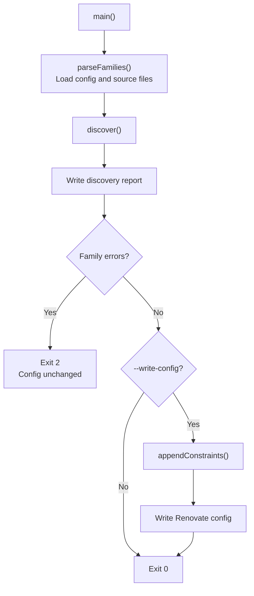
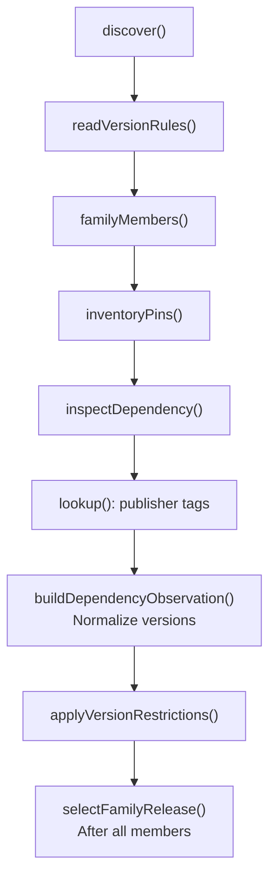
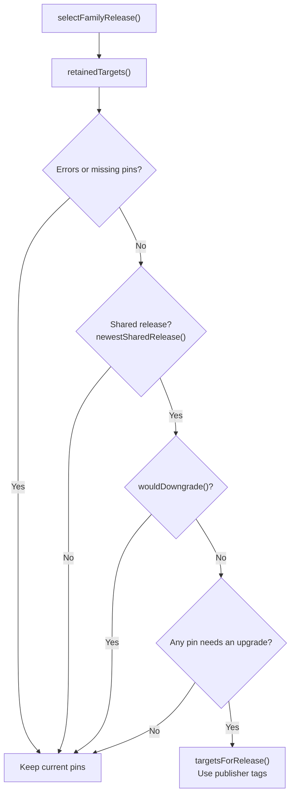

# Renovate scripts

This directory contains shared-release discovery and Renovate PR readiness scripts. Discovery selects compatible application versions before a separate Renovate run. The readiness scripts compare PR changes for the existing [renovate-readiness action](../../.github/actions/renovate-readiness/action.yaml).

## Shared-release discovery

[`discover-versions.ts`](discover-versions.ts) selects the newest eligible application release available across every required image in [`app-families.yaml`](../../app-families.yaml). It retains current pins when no shared upgrade exists or an update would downgrade a pin. Existing grouping and unrelated Renovate updates remain unchanged.

Discovery produces two distinct outputs:

- **Discovery report**: JSON diagnostic/results data recording current pins, selected releases, publisher gaps, and failures. It is not Renovate configuration.
- **Renovate config**: the configuration discovery reads to honor existing restrictions. With `--write-config`, discovery appends constraints to this same file.

Use the repository's Node version and install Git, GitHub CLI (`gh`), and the repository-pinned `crane`. Discovery uses your existing `gh` authentication and registry logins or Docker credential helpers.

### 1. Inspect available shared releases

Run these commands from `scripts/renovate` to write a discovery report without changing the Renovate config. The `--report` destination is required:

```bash
npm ci
npx --no-install tsx discover-versions.ts --report /tmp/shared-release-report.json
```

Defaults come from the checkout containing the script: `app-families.yaml`, `renovate.json`, and manifest `sourceFiles`. Explicit relative paths for `--families-file`, `--config`, and `--report` resolve from your working directory. Manifest source paths remain checkout-relative even with an alternate manifest. For focused troubleshooting, use `--families-file /tmp/focused-families.yaml` with only the families you want to inspect.

Exit `0` means discovery completed, including legitimate gaps or held upgrades. Exit `2` writes family-error diagnostics to the discovery report without changing config. Exit `1` means an input or command failure. A failure can leave an older report at the output path, so check the exit code before consuming it. The report records the checkout's current `HEAD`; discovery does not switch branches or enforce a clean `main` checkout.

### 2. Generate constraints safely

Use `--config` to target a temporary copy of `renovate.json`, leaving your checkout unchanged. This option selects both the input config and the file modified by `--write-config`:

```bash
workdir=$(mktemp -d)
cp ../../renovate.json "$workdir/renovate.json"
npx --no-install tsx discover-versions.ts --report "$workdir/discovery-report.json" --config "$workdir/renovate.json" --write-config
```

Start each run with the original config; do not commit generated constraints. Without `--config`, `--write-config` modifies your checkout's `renovate.json`. The script does not run Renovate itself.

### 3. Validate the resulting Renovate config

With UDS CLI and a running Docker daemon, validate the temporary config using the [shared validation task](../../tasks/lint.yaml). Continue from `scripts/renovate` in the same shell:

```bash
uds run -f ../../tasks/lint.yaml renovate --with file="$workdir/renovate.json"
```

Pass the Renovate config, not the discovery report. The task uses the same digest-pinned Renovate image locally and in CI, independently of your host Node version.

### Read discovery progress

Discovery prints progress and a final summary to stderr: publisher lookup starts and tag counts, each family's status and selected release, the discovery-report path, and whether discovery wrote or left config unchanged. Lookup progress appears once per publisher lookup, even when multiple roles share it. On failure, the final recap lists each failed family and affected publishers, failure kinds, and roles. Publishers shared across roles appear once per failure kind in that family's recap.

Publisher and preset failures report the command name and available safe metadata: numeric exit codes, recognized HTTP statuses, and known process error codes or termination signals. They do not print raw command output or response bodies; unknown failure details remain unavailable.

### Discovery flow

[`discover-versions.ts`](discover-versions.ts) owns CLI arguments, files, and discovery orchestration. [`publisher-sources.ts`](publisher-sources.ts) handles `gh` and `crane` access; [`shared-releases.ts`](shared-releases.ts) owns domain types, pin interpretation, version restrictions, selection, and constraint generation. These diagrams follow the execution paths across those modules.

#### Script execution and outputs

`main()` loads inputs and writes the discovery report before considering config changes. Thrown input or command errors exit `1`.



#### Dependency discovery and policy

`discover()` loads policy once, then inspects each family's members before selection. The diagram shows the successful inspection path. `createCliVersionSources()` supplies publisher and preset clients through `gh api` and `crane ls`; discovery reuses publisher lookups by datasource and package.



`applyVersionRestrictions()` uses `restrictionsForPin()` and `isEligibleRelease()` to evaluate each release against every current pin. `inspectDependency()` records lookup failures and unsupported applicable policies as family errors instead of selecting from incomplete or unsupported data.

#### Shared-release selection

`selectFamilyRelease()` starts with current targets. It replaces them only when every member has an eligible shared release, no pin would downgrade, and at least one pin needs an upgrade.



The family status distinguishes errors, absent shared releases, blocked downgrades, current versions, and available updates. Held selections retain their original pins; update targets preserve publisher tags and prefer the current tag format.

### Add a dependency

Use `app-families.yaml` as the inventory and source of publisher-specific examples. Add a separate family for each independent application release stream, even when Renovate groups those components into one PR.

For an image-only application, add an entry under `families` using this pattern, then include every required image and flavor:

```yaml title="app-families.yaml"
- name: example
  sourceFiles: [src/example/zarf.yaml]
  appDependency:
    datasource: docker
    packageName: example.com/team/app
    # Capture the application version, not a Helm chart version.
    tagPattern: '^(?<version>\d+\.\d+\.\d+)$'
  flavors:
    upstream:
      images:
        - repository: example.com/team/app
          tagPattern: '^(?<version>\d+\.\d+\.\d+)$'
```

List every file containing the family's pins in `sourceFiles`. Use `github-tags` for a GitHub-tagged application source when appropriate. Patterns must match actual publisher tags and capture comparable versions in the named `version` group; prefixes and suffixes stay in the original tags. Run `npm test`, then inspect a fresh discovery report before enabling config writing. Unsupported applicable restrictions produce an error rather than a guessed selection.

Restriction selectors support case-insensitive globs and `/pattern/i` regexes, matching Renovate. Semver `allowedVersions` bounds require the publisher tag, after any existing `extractVersion`, to parse as the same semver as the normalized application version. Otherwise discovery reports `unsupported` and leaves config unchanged. This prevents normalization from removing meaningful prefixes or suffixes before generated constraints replace the original bounds.

## Readiness checks

The existing action uses these scripts to compare images and charts between checkouts. The comparison script reports changes and labels; the action applies those labels to the PR.

### getImagesAndCharts.ts

Extracts images and charts from `zarf.yaml` files in a given directory path. Run it from `scripts/renovate`:

```bash
# From within the scripts/renovate directory
npx --no-install tsx getImagesAndCharts.ts <directory-path>
```

The script performs these steps:

1. Recursively find all `zarf.yaml` files in the specified directory
2. Extract Helm charts and container images from these files
3. Write the extracted data to `extract/charts.yaml` and `extract/images.yaml` under that directory

### compareImagesAndCharts.ts

Compares images and charts between two `extract` folders from `getImagesAndCharts.ts`. Run it from `scripts/renovate`:

```bash
# From within the scripts/renovate directory
npx --no-install tsx compareImagesAndCharts.ts <old-extract-path> <new-extract-path>
```

The script performs these steps:

1. Compare chart versions between old and new, detecting major updates
2. Compare image versions between old and new, detecting major updates
3. Identify if the PR is waiting on Iron Bank or Unicorn image updates
4. Output a list of changes and labels to apply to the PR

### Labels

The comparison script reports these labels for the action to apply:

- `waiting on ironbank`: If a registry1 image is behind
- `waiting on unicorn`: If a Unicorn image is behind
- `helm-chart-only`: If a PR only contains a helm chart update
- `needs-review`: If the PR has no waiting labels and is not a chart-only update
- `major-helm-update`: If the PR contains a major chart version bump
- `major-image-update`: If the PR contains a major image version bump

## Testing

From `scripts/renovate`, run type checking and unit tests:

```bash
npm test
```

Discovery calls GitHub through `gh`, so those tests supply known command responses and check the requests and output parsing. This makes pagination, release dates, prerelease flags, and failure cases repeatable without depending on GitHub availability, credentials, or changing releases.

Registry tests run the installed `crane` against an authenticated local registry. A mocked tag list would not prove that the real CLI uses Docker credentials and credential helpers, follows pagination, or fails when a later page cannot be read. The local registry checks those boundaries with known data and failures, without requiring publisher accounts.

With UDS CLI and Docker available, run the test suite with container validation enabled from the same directory:

```bash
npm run test:config
```

Unit tests can confirm that generated rules have the expected shape, but not that Renovate accepts them. This check generates constraints for one representative family on top of the real repository configuration, then runs Renovate's actual validator. It catches unsupported options and invalid regexes and confirms that validation errors produce a failing command. The pinned container keeps Renovate, Node, and the native RE2 regex engine consistent between local and CI runs.

Scripts CI runs the same command. Without this opt-in, the suite skips container validation because it requires Docker. This validates configuration compatibility, not Renovate's extraction/update execution or access to live publishers.

## Related documentation

- [Application families](../../app-families.yaml): dependency inventory and publisher tag patterns.
- [Renovate readiness action](../../.github/actions/renovate-readiness/README.md): existing PR checks and label handling.
