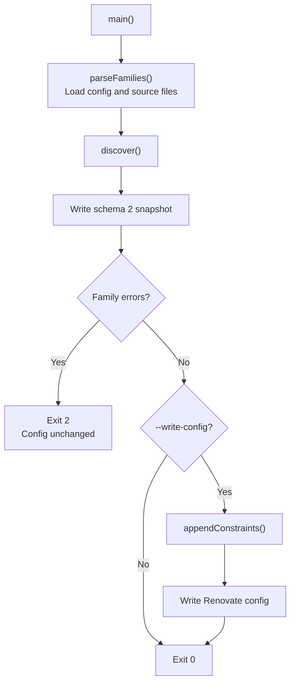
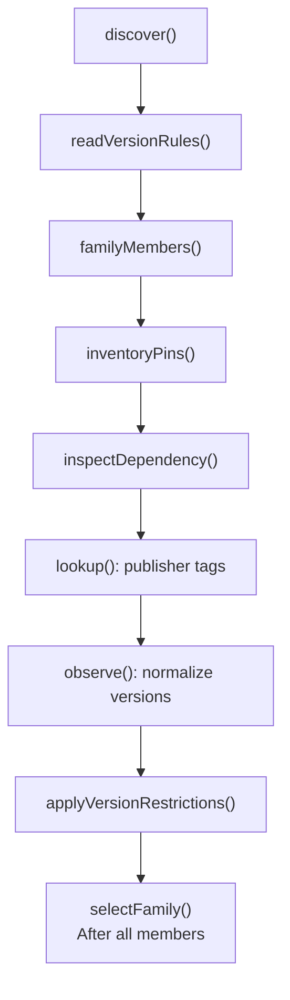
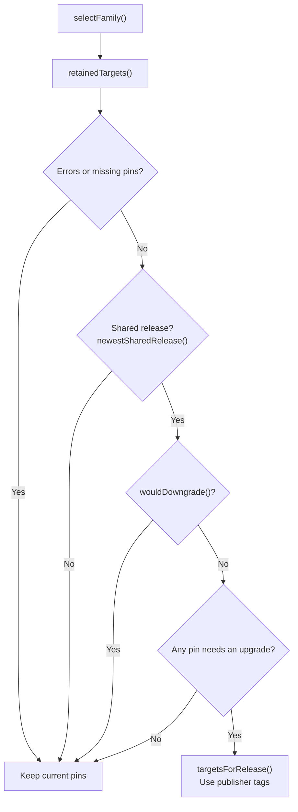

# Renovate scripts

This directory contains shared-release discovery and Renovate PR readiness scripts. Discovery selects compatible application versions before a separate Renovate run. The readiness scripts compare PR changes for the existing [renovate-readiness action](../../.github/actions/renovate-readiness/action.yaml).

## Shared-release discovery

[`discover-versions.ts`](discover-versions.ts) selects the newest eligible application release available across every required image in [`app-families.yaml`](../../app-families.yaml). It retains current pins when no shared upgrade exists or an update would downgrade a pin. Existing grouping and unrelated Renovate updates remain unchanged.

Use the repository's Node version and install Git, GitHub CLI (`gh`), and the repository-pinned `crane`. Discovery uses your existing `gh` authentication and registry logins or Docker credential helpers. Run these commands from `scripts/renovate`:

```bash
npm ci
npm test
npx --no-install tsx discover-versions.ts --output /tmp/app-versions.json
```

Add `--write-config` to also append constraints to `../../renovate.json`. This changes your checkout's config, so use a disposable checkout for manual testing:

```bash
npx --no-install tsx discover-versions.ts --output /tmp/app-versions.json --write-config
```

Exit `0` means discovery completed, including legitimate gaps or held upgrades. Exit `2` writes family-error diagnostics to the snapshot without changing config. Exit `1` means an input or command failure. Start each run with the original config; do not commit generated constraints. The script does not run Renovate itself.

Discovery prints progress and a final summary to stderr: publisher lookup starts and tag counts, each family's status and selected release, the snapshot path, and whether it wrote or left config unchanged. Lookup progress appears once per publisher lookup, even when multiple roles share it. On failure, the final recap lists each failed family and affected publishers, failure kinds, and roles. Publishers shared across roles appear once per failure kind in that family's recap.

Publisher and preset failures report the command name and available safe metadata: numeric exit codes, recognized HTTP statuses, and known process error codes or termination signals. They do not print raw command output or response bodies; unknown failure details remain unavailable.

The snapshot uses `schemaVersion: 2` and contains `observedAt`, `mainSha`, and per-family decisions, dependencies, targets, and publisher gaps. `mainSha` records the current `HEAD`; the script does not switch branches or enforce a clean `main` checkout.

Override input locations with `--repo-root`, `--families`, or `--repo-config`. CLI paths resolve from your working directory; manifest `sourceFiles` resolve from `--repo-root`.

### Validate configuration

From the repository root, validate a generated Renovate config with the [shared validation task](../../tasks/lint.yaml):

```bash
uds run lint:renovate --with file=/absolute/path/to/all-config.json
```

This requires UDS CLI and a running Docker daemon. The task uses the same digest-pinned Renovate image locally and in CI, independently of your host Node version. Pass the generated config, not the discovery snapshot.

### Discovery flow

These diagrams separate script execution, dependency inspection, and selection paths in `discover-versions.ts`.

#### Script execution and outputs

`main()` loads inputs and writes the snapshot before considering config changes. Thrown input or command errors exit `1`; a failure can leave an older snapshot at the output path, so check the exit code before consuming it.



#### Dependency discovery and policy

`discover()` loads policy once, then inspects each family's members before selection. The diagram shows the successful inspection path. `createVersionSources()` supplies publisher and preset clients through `gh api` and `crane ls`; discovery reuses publisher lookups by datasource and package.



`applyVersionRestrictions()` uses `restrictionsForPin()` and `isEligibleRelease()` to evaluate each release against every current pin. `inspectDependency()` records lookup failures and unsupported applicable policies as family errors instead of selecting from incomplete or unsupported data.

#### Shared-release selection

`selectFamily()` starts with current targets. It replaces them only when every member has an eligible shared release, no pin would downgrade, and at least one pin needs an upgrade.



The family status distinguishes errors, absent shared releases, blocked downgrades, current versions, and available updates. Held selections retain their original pins; update targets preserve publisher tags and prefer the current tag format.

### Add a dependency

Use `app-families.yaml` as the inventory and source of publisher-specific examples. Add a separate family for each independent application release stream, even when Renovate groups those components into one PR.

For an image-only application, add an entry under `families` using this pattern, then include every required image and flavor:

```yaml title="app-families.yaml"
- name: example
  sourceFiles: [src/example/zarf.yaml]
  appDependency:
    datasource: docker
    packageName: example.com/team/app
    # Capture the application version, not a Helm chart version.
    tagPattern: &exampleVersion '^(?<version>\d+\.\d+\.\d+)$'
  flavors:
    upstream:
      images:
        - repository: example.com/team/app
          tagPattern: *exampleVersion
```

List every file containing the family's pins in `sourceFiles`. Use `github-tags` for a GitHub-tagged application source when appropriate. Patterns must match actual publisher tags and capture comparable versions in the named `version` group; prefixes and suffixes stay in the original tags. Run `npm test`, then inspect a fresh snapshot before enabling config writing. Unsupported applicable restrictions produce an error rather than a guessed selection.

Restriction selectors support case-insensitive globs and `/pattern/i` regexes, matching Renovate. Semver `allowedVersions` bounds require the publisher tag, after any existing `extractVersion`, to parse as the same semver as the normalized application version. Otherwise discovery reports `unsupported` and leaves config unchanged. This prevents normalization from removing meaningful prefixes or suffixes before generated constraints replace the original bounds.

## Readiness checks

The existing action uses these scripts to compare images and charts between checkouts. The comparison script reports changes and labels; the action applies those labels to the PR.

### getImagesAndCharts.ts

Extracts images and charts from `zarf.yaml` files in a given directory path. Run it from `scripts/renovate`:

```bash
# From within the scripts/renovate directory
npx --no-install tsx getImagesAndCharts.ts <directory-path>
```

The script performs these steps:

1. Recursively find all `zarf.yaml` files in the specified directory
2. Extract Helm charts and container images from these files
3. Write the extracted data to `extract/charts.yaml` and `extract/images.yaml` under that directory

### compareImagesAndCharts.ts

Compares images and charts between two `extract` folders from `getImagesAndCharts.ts`. Run it from `scripts/renovate`:

```bash
# From within the scripts/renovate directory
npx --no-install tsx compareImagesAndCharts.ts <old-extract-path> <new-extract-path>
```

The script performs these steps:

1. Compare chart versions between old and new, detecting major updates
2. Compare image versions between old and new, detecting major updates
3. Identify if the PR is waiting on Iron Bank or Unicorn image updates
4. Output a list of changes and labels to apply to the PR

### Labels

The comparison script reports these labels for the action to apply:

- `waiting on ironbank`: If a registry1 image is behind
- `waiting on unicorn`: If a Unicorn image is behind
- `helm-chart-only`: If a PR only contains a helm chart update
- `needs-review`: If the PR has no waiting labels and is not a chart-only update
- `major-helm-update`: If the PR contains a major chart version bump
- `major-image-update`: If the PR contains a major image version bump

## Testing

From `scripts/renovate`, run type checking and unit tests:

```bash
npm test
```

The suites cover these boundaries:

| Suite                                                                                                                          | Coverage                                                                                                                        |
| ------------------------------------------------------------------------------------------------------------------------------ | ------------------------------------------------------------------------------------------------------------------------------- |
| [`selection.spec.ts`](selection.spec.ts)                                                                                       | Shared-release intersections, downgrade prevention, tag/extraction formats, generated constraints, and inherited restrictions.  |
| [`discover-versions.spec.ts`](discover-versions.spec.ts)                                                                       | Manifest pins, command outputs and exit codes, config-write guards, failure reporting, and GitHub publisher requests/responses. |
| [`registry-tags.spec.ts`](registry-tags.spec.ts)                                                                               | Bounded pagination, Docker credentials/helpers, authentication failures, and rejection of partial catalogs.                     |
| [`getImagesAndCharts.spec.ts`](getImagesAndCharts.spec.ts), [`compareImagesAndCharts.spec.ts`](compareImagesAndCharts.spec.ts) | Existing readiness image/chart extraction and comparison.                                                                       |

GitHub tests inject CLI responses. Registry tests invoke real `crane` against an authenticated local registry and temporary Docker configuration, not live publishers. These tests do not verify access to your publisher accounts.

With UDS CLI and Docker available, run the container integration check from the same directory:

```bash
npm run test:config
```

This generates constraints for one representative family on top of the real repository configuration using controlled publisher data. It validates the result with the shared Renovate container task and checks that invalid configuration fails. Scripts CI runs the same command; the normal unit suite skips this Docker-dependent check. It checks configuration compatibility, not Renovate's extraction/update execution or live publisher availability.

## Related documentation

- [Application families](../../app-families.yaml): dependency inventory and publisher tag patterns.
- [Renovate readiness action](../../.github/actions/renovate-readiness/README.md): existing PR checks and label handling.
